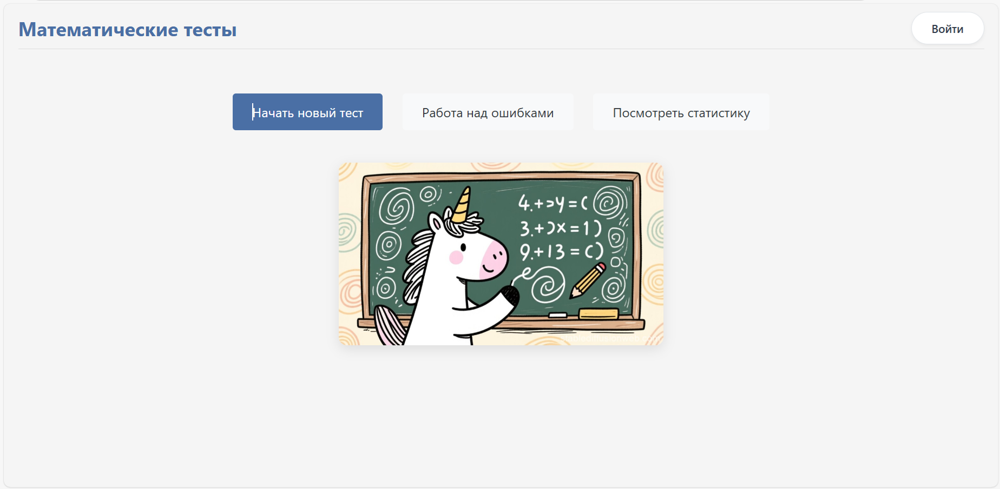
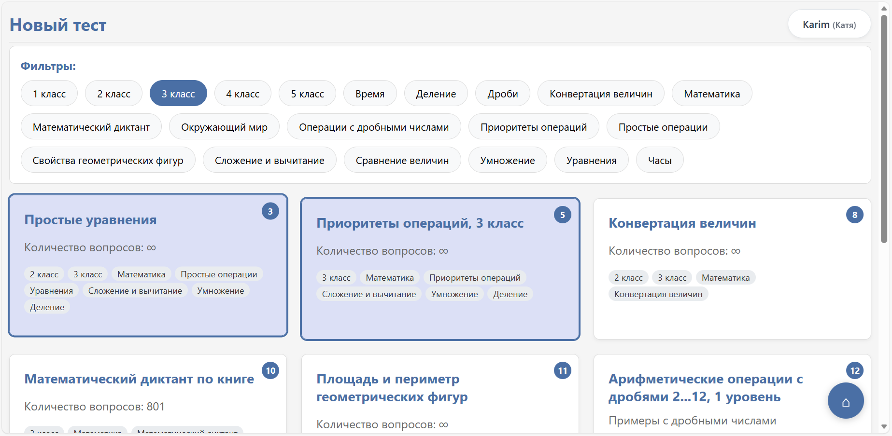
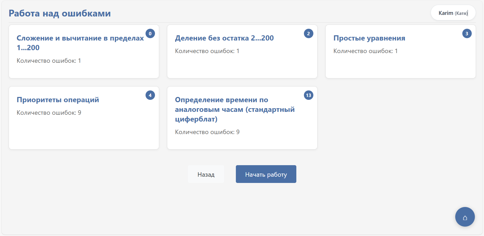
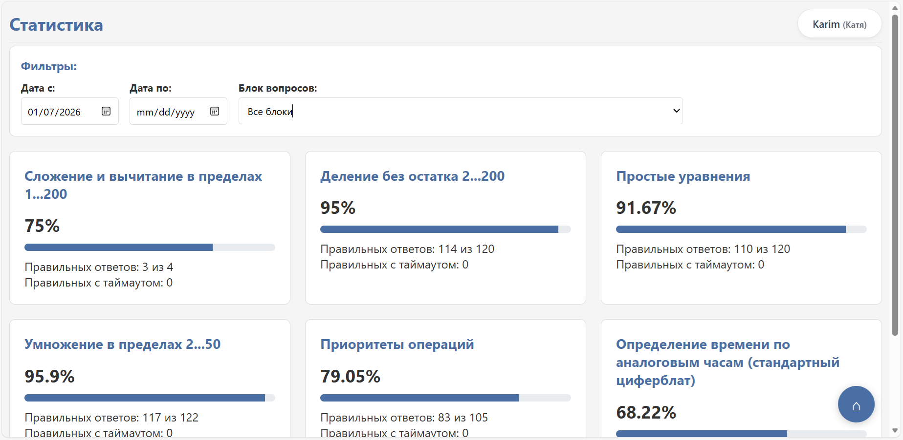
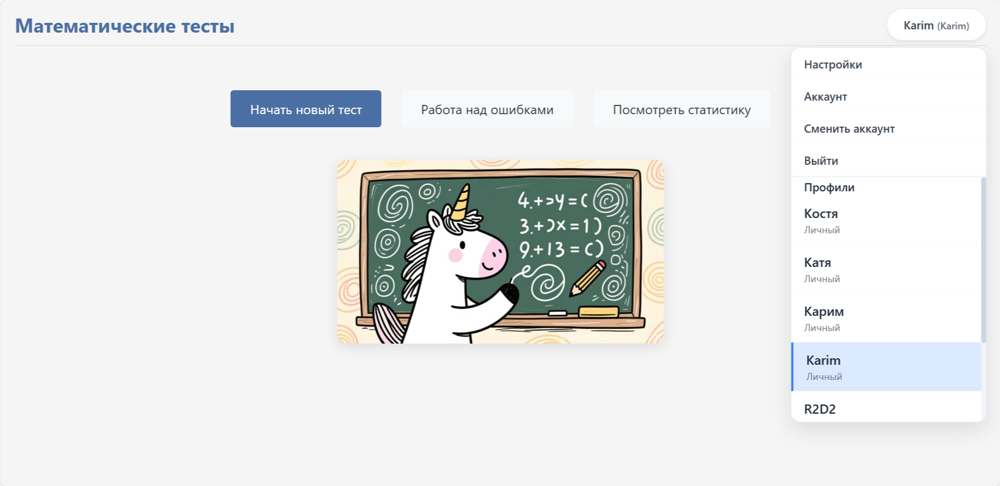
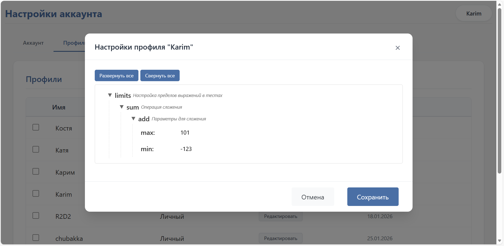
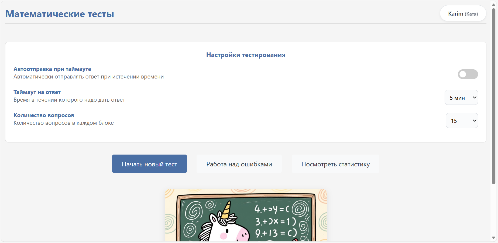
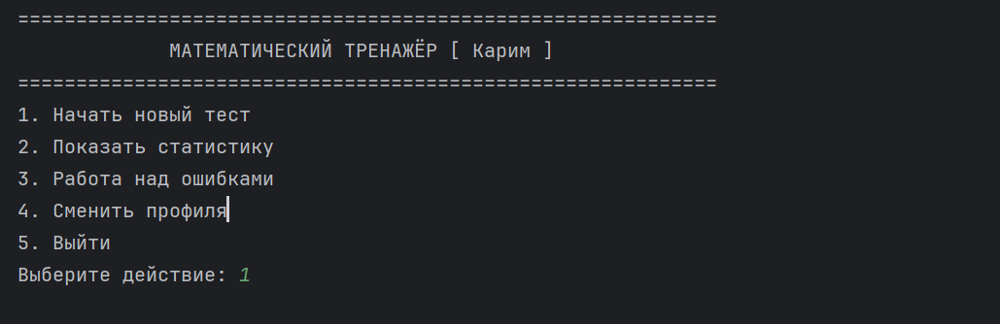

# Math test generator for age 7-11

*[Русская версия](README_RU.md)*

## Purpose
This application was created to help children practice and master foundational mathematics.
It provides customizable, automatically generated exercises covering core operations,
with progressively challenging tasks to track and support learning progress.
While most problems are auto-generated, the system also includes a set of predefined questions.

## Targets
* For Students: To enhance mathematical skills and develop the ability to work effectively under time constraints.
* For Parents: To monitor their child's progress and performance through detailed statistics.
* For Teachers: To create custom assignments and track student completion and mastery. (Future option)

## Features
* Auto-generation of questions by topic
* Tests defined in YAML format
* Web interface
* Command-line interface
* Task time tracking and control
* Customizable test completion criteria
* Functionality for both anonymous and registered users
* Session support with pause and resume capabilities
* Test history and results
* Mistake review and correction
* Detailed testing statistics
* Ability to create custom exercise generators

## Before first start
Install requirements
```bash
pip install -r requirements.txt
```
## Start
To start web server
```bash
python math_test.py --server
```
To start console app
```bash
python math_test.py --console
```

## Docker

The project is built in two variants:

| Image | Dockerfile | Purpose | Pages | Protocol |
|-------|------------|---------|-------|----------|
| Local / personal | `Dockerfile` | debugging and personal use | app (`/app`) and help (`/help`) only | HTTP |
| Production | `Dockerfile.prod` | external users | all pages (landing, app, help, footer) | HTTPS (nginx + gunicorn) |

The page set is controlled by `APP_PAGES_MODE`:
- `full` (default) — all pages;
- `minimal` — no landing page (`/` redirects to `/app`) and no footer (`/footer.html` returns 404).

### Local Development (HTTP, minimal page set)

Build the Docker image:
```bash
docker build -t math-test-app .
```

Run the container locally with database persistence:
```bash
docker run -d -p 5000:5000 \
  -v ./data:/app/data \
  --name math-test \
  math-test-app
```

The web application will be available at http://localhost:5000 (`/` redirects to `/app`).

**Notes:**
- The `-v ./data:/app/data` flag mounts a host directory for database persistence. Data will survive container restarts and recreations.
- The database file (`app.db`) will be stored in the `./data` directory relative to your working directory.
- On Windows CMD, use: `docker run -d -p 5000:5000 -v %cd%\data:/app/data --name math-test math-test-app`
- On Windows PowerShell, use: `docker run -d -p 5000:5000 -v ${PWD}\data:/app/data --name math-test math-test-app`

**WSL Compatibility:** The container works correctly from WSL. The port mapping (`-p 5000:5000`) makes the service accessible at `http://localhost:5000` from both WSL and Windows.

### Production Deployment (HTTPS via nginx reverse proxy)

The production image runs gunicorn (WSGI) behind nginx, which terminates TLS.
Certificates are mounted into `/etc/nginx/certs`; their paths are configurable via environment variables.

Build the production image:
```bash
docker build -f Dockerfile.prod -t math-test-prod .
```

Run with your TLS certificates:
```bash
docker run -d -p 80:80 -p 443:443 \
  -e SERVER_NAME=server.com \
  -e TLS_CERT_FILE=/etc/nginx/certs/certificate.crt \
  -e TLS_KEY_FILE=/etc/nginx/certs/certificate.key \
  -v /path/to/persistent/data:/app/data \
  -v /path/to/certs/server.com:/etc/nginx/certs:ro \
  -v /path/to/private:/etc/nginx/certs:ro \
  --name math-test-prod \
  math-test-prod
```

Certificates can also be placed directly at `/etc/nginx/certs/certificate.crt` and
`/etc/nginx/certs/certificate.key` — in that case `TLS_CERT_FILE`/`TLS_KEY_FILE` may be omitted.

**Environment variables (production):**

| Variable | Default | Description |
|----------|---------|-------------|
| `SERVER_NAME` | `_` | domain for nginx (`server_name`) |
| `HTTP_PORT` | `80` | HTTP port (redirects to HTTPS) |
| `HTTPS_PORT` | `443` | HTTPS port |
| `TLS_CERT_FILE` | `/etc/nginx/certs/certificate.crt` | path to the certificate |
| `TLS_KEY_FILE` | `/etc/nginx/certs/certificate.key` | path to the private key |
| `GUNICORN_BIND` | `127.0.0.1:8000` | gunicorn bind address (internal) |
| `GUNICORN_WORKERS` | `3` | number of gunicorn workers |
| `APP_PAGES_MODE` | `full` | page set (`full`/`minimal`) |
| `JWT_COOKIE_SECURE` | `1` | cookies over HTTPS only |
| `JWT_SECRET_KEY` / `JWT_PRIVATE_KEY` | from file | JWT secrets (otherwise created in the DB directory) |
| `OPERATOR_NAME` | `Владелец сайта math_test` | personal data operator (152-FZ), shown on `/policy` and `/consent` |
| `OPERATOR_ADDRESS` | `не указан` | operator address |
| `OPERATOR_EMAIL` | `не указан` | contact for personal-data requests |
| `OPERATOR_URL` | (empty) | operator website |
| `POLICY_DATE` | `2026-01-01` | revision date of the legal documents |

**Note:** `JWT_COOKIE_SECURE=1` requires HTTPS. For local development over plain HTTP (http://localhost:5000) do not set it, otherwise the browser will not store the authentication cookies.

**152-FZ (personal data):** before going live, set the `OPERATOR_*` variables to the actual operator details and `POLICY_DATE` to the revision date. They are rendered on the `/policy` (политика обработки персональных данных) and `/consent` (согласие) pages, which are linked from the footer and the registration form. Public pages show a cookie/consent notice to new visitors; the consent flag and its date are stored per user in the database.

## UI
By default, the web page will be available at http://localhost:5000

### Web page







### Settings
#### Profile Management
To create a new profile, navigate to the account page via the menu and create a new profile.

You can then configure limits either immediately when creating the profile or later through profile editing.
If limits are not set, default values will be used.

#### Test Parameter Settings
On the main page, click the "Settings" item in the menu to open the panel:


### Console
Most of the test functionality is available in the console (except for features requiring HTML markup).


## Contribution

We welcome contributions and ideas to extend the functionality of this project!
Whether it's fixing a bug, adding a new feature, improving documentation, or suggesting a new type of math exercise.
Feel free to:
* Fork the repository.
* Create a branch for your changes.
* Submit a Pull Request with a clear description of your improvements.
If you have any questions or want to discuss a potential feature, please open an Issue on GitHub.
Let’s make learning math more engaging together!

## License
This project is licensed under the MIT License.
You are free to use, modify, and distribute the software, subject to the terms and conditions of the MIT License.
For more details, see the *[LICENSE](LICENSE)* file in the project repository.
