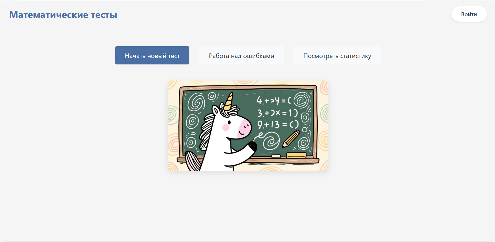
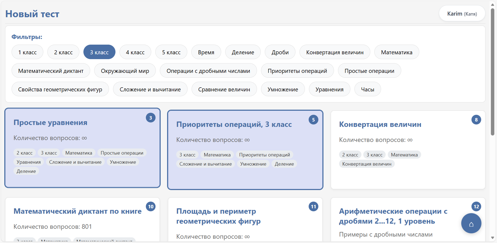
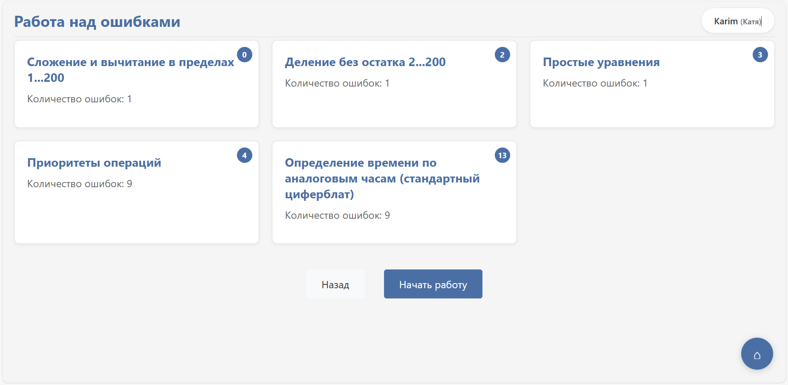
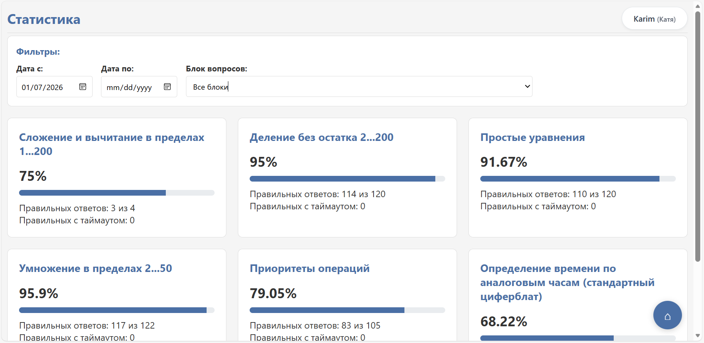
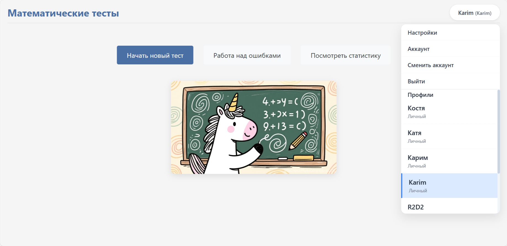
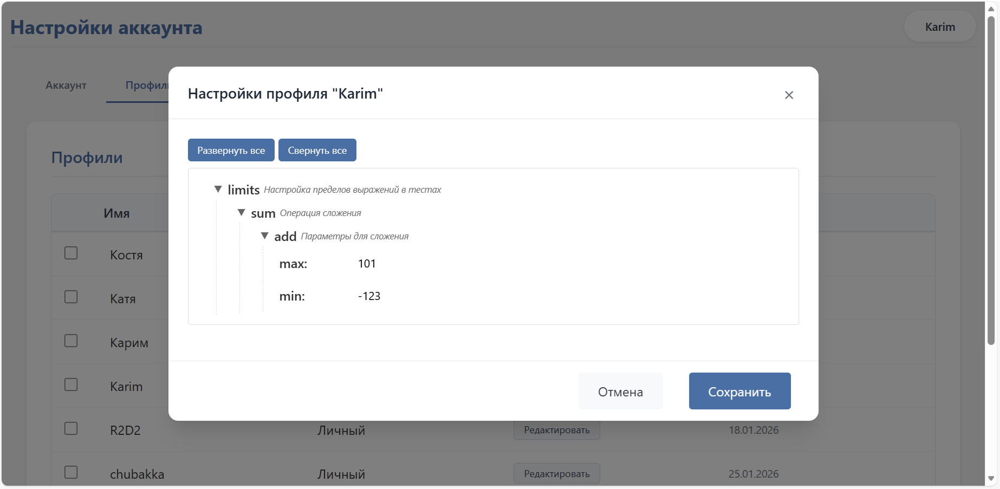
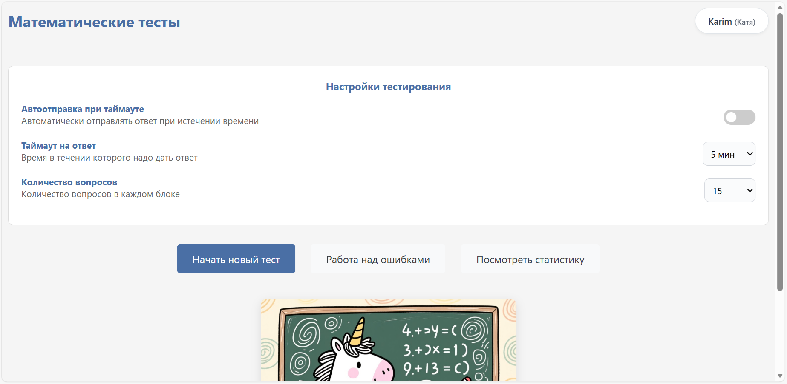
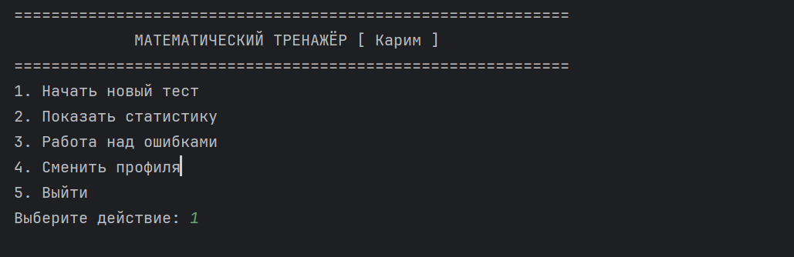

# Генератор тестов по математике для детей 7–11 лет

*[English version](README.md)*

## Назначение
Это приложение было создано, чтобы помочь моим детям практиковаться и осваивать основы математики.
Оно предоставляет настраиваемые, автоматически генерируемые задания начиная с самых базовых операций.
Уровень заданий постепенно усложняется по мере роста прогресса в обучении. 
Хотя большинство задач генерируются автоматически, приложение также включает набор предопределённых вопросов.

## Цели
* Для учеников: Развитие математических навыков и умения эффективно работать в условиях ограниченного времени.
* Для родителей: Возможность отслеживать прогресс и успехи своего ребёнка с помощью истории и статистики.
* Для учителей: Создание индивидуальных заданий и мониторинг их выполнения и усвоения учениками. (В планах)

## Функции
* Автогенерация заданий по разделам
* Тесты описанные в формате YAML
* Веб-интерфейс
* Консольный интерфейс
* Контроль времени выполнения задания
* Настройка условий прохождения теста
* Функционал для анонимных пользователей и зарегистрированных пользователей
* Поддержка сессий с возможностью прерывания и возобновления теста
* История тестирования
* Работа над ошибками
* Статистика тестирования

## Перед первым запуском
Установка зависимостей
```bash
pip install -r requirements.txt
```
## Старт
Запуск веб-сервера
```bash
python math_test.py --server
```
Запуск консольного приложения
```bash
python math_test.py --console
```

## Docker

Проект собирается в двух вариантах:

| Образ | Dockerfile | Назначение | Страницы | Протокол |
|-------|------------|------------|----------|----------|
| Локальный / персональный | `Dockerfile` | отладка и личный запуск | только приложение (`/app`) и инструкция (`/help`) | HTTP |
| Боевой | `Dockerfile.prod` | сторонние пользователи | все страницы (заглавная, приложение, инструкция, футер) | HTTPS (nginx + gunicorn) |

Набор страниц задаётся переменной `APP_PAGES_MODE`:
- `full` (по умолчанию) — все страницы;
- `minimal` — без заглавной страницы (`/` редиректит на `/app`) и без футера (`/footer.html` отдаёт 404).

### Локальный запуск (HTTP, минимальный набор страниц)

Сборка образа:
```bash
docker build -t math-test-app .
```

Запуск контейнера с сохранением базы данных:
```bash
docker run -d -p 5000:5000 \
  -v ./data:/app/data \
  --name math-test \
  math-test-app
```

Приложение будет доступно по адресу http://localhost:5000 (`/` редиректит на `/app`).

**Примечания:**
- Флаг `-v ./data:/app/data` монтирует каталог хоста для хранения базы. Данные сохраняются между перезапусками и пересозданием контейнера.
- Файл базы (`app.db`) будет создан в каталоге `./data` относительно текущего каталога.
- В Windows CMD: `docker run -d -p 5000:5000 -v %cd%\data:/app/data --name math-test math-test-app`
- В Windows PowerShell: `docker run -d -p 5000:5000 -v ${PWD}\data:/app/data --name math-test math-test-app`

**Совместимость с WSL:** контейнер корректно работает из WSL. Проброс порта (`-p 5000:5000`) делает сервис доступным по `http://localhost:5000` как из WSL, так и из Windows.

### Боевое развёртывание (HTTPS через nginx reverse proxy)

Боевой образ запускает gunicorn (WSGI) за nginx, который терминирует TLS.
Сертификаты монтируются в `/etc/nginx/certs`, их пути настраиваются переменными окружения.

Сборка боевого образа:
```bash
docker build -f Dockerfile.prod -t math-test-prod .
```

Запуск со своими сертификатами:
```bash
docker run -d -p 80:80 -p 443:443 \
  -e SERVER_NAME=example.com \
  -e TLS_CERT_FILE=/etc/nginx/certs/fullchain.pem \
  -e TLS_KEY_FILE=/etc/nginx/certs/privkey.pem \
  -v /path/to/persistent/data:/app/data \
  -v /etc/letsencrypt/live/example.com:/etc/nginx/certs:ro \
  --name math-test-prod \
  math-test-prod
```

Сертификаты также можно положить напрямую в `/etc/nginx/certs/fullchain.pem` и
`/etc/nginx/certs/privkey.pem` — тогда `TLS_CERT_FILE`/`TLS_KEY_FILE` можно не задавать.

**Переменные окружения (production):**

| Переменная | По умолчанию | Описание |
|------------|--------------|----------|
| `SERVER_NAME` | `_` | домен для nginx (`server_name`) |
| `HTTP_PORT` | `80` | порт HTTP (редирект на HTTPS) |
| `HTTPS_PORT` | `443` | порт HTTPS |
| `TLS_CERT_FILE` | `/etc/nginx/certs/fullchain.pem` | путь к сертификату |
| `TLS_KEY_FILE` | `/etc/nginx/certs/privkey.pem` | путь к приватному ключу |
| `GUNICORN_BIND` | `127.0.0.1:8000` | адрес gunicorn (внутренний) |
| `GUNICORN_WORKERS` | `3` | число воркеров gunicorn |
| `APP_PAGES_MODE` | `full` | набор страниц (`full`/`minimal`) |
| `JWT_COOKIE_SECURE` | `1` | cookie только по HTTPS |
| `JWT_SECRET_KEY` / `JWT_PRIVATE_KEY` | из файла | секреты JWT (иначе создаются в каталоге БД) |

**Примечание:** `JWT_COOKIE_SECURE=1` требует HTTPS. Для локальной разработки по HTTP (http://localhost:5000) не задавайте его, иначе браузер не сохранит cookie аутентификации.

## UI
По умолчанию веб-страница будет доступна по адресу http://localhost:5000
### Web страница







### Настройки
#### Управление профилями
Для создания нового профиля надо перейти через меню на страницу аккаунта и создать новый профиль.

Далее можно настроить лимиты, либо сразу при создании профиля, либо позже через редактирование профиля.
Если лимиты не заданы, будут использоваться дефолтные.

#### Настройки параметров теста
На главной странице в меню кликнуть пункт "Настройки", откроется панель:


### Консоль
Большая часть функционала тестов доступна в консоли (за исключением требующих html разметки). 


## Участие в разработке
Мы приветствуем вклад и идеи по расширению функциональности этого проекта!
Будь то исправление ошибки, добавление новой функции, улучшение документации или предложение нового типа математического задания.
Вы можете:
* Сделать форк репозитория.
* Создать ветку для ваших изменений.
* Отправить Pull Request с понятным описанием ваших улучшений.
Если у вас есть вопросы или вы хотите обсудить возможную новую функцию, пожалуйста, откройте Issue на GitHub.
Давайте сделаем изучение математики более увлекательным вместе!

## Лицензия
Этот проект распространяется под лицензией MIT.
Вы можете свободно использовать, изменять и распространять программное обеспечение в соответствии с условиями лицензии MIT.
Подробнее см. в файле *[LICENSE](LICENSE)* в репозитории проекта.


